<picture>
  <source media="(prefers-color-scheme: dark)" srcset="assets/banner-dark.svg">
  
</picture>

  <a href="https://piwowarpawel.com/">piwowarpawel.com</a> ·
  <a href="https://radar.piwowarpawel.com/en/">Career Radar</a> ·
  <a href="https://www.linkedin.com/in/pawelpiwowar88/">LinkedIn</a> ·
  <a href="https://www.credly.com/users/pawel-piwowar.56832a3a/badges/credly">Credly</a> ·
  <a href="https://learn.microsoft.com/en-us/users/pawepiwowar/transcript/vn6rwsyj1lqylkq">Microsoft Learn</a>

## Hi, I'm Paweł 👋

Self-taught, I went from PC building and IT support to DevOps. These days that means Azure, IONOS
and VMware, infrastructure as code, automating repeatable work and making sure the logs help when
something breaks. Next on my path are platform engineering, AI infrastructure and cloud
architecture.

## What I work on

- **Hybrid cloud.** 80+ cloud subscriptions and 1,000+ virtual machines in the environment I work
  with, together with 15+ teams.
- **Infrastructure as code.** Terraform, Ansible and Bicep in Git, with around 70% of provisioning
  automated.
- **Observability.** A Grafana stack I built and run, with 50 dashboards as code and millions of
  log lines a day in VictoriaLogs.
- **Migrations.** Co-led a production move from VMware vCenter to Azure and IONOS, and now driving
  a second, larger one.
- **AI-assisted engineering.** Claude, ChatGPT and Copilot for code, reviews and documentation,
  with every change reviewed before it ships.

## Projects

| Project | What it is | Built with |
|---|---|---|
| [piwowarpawel.com](https://piwowarpawel.com/) | My EN/PL portfolio, released like a production service with STAGE checks and an approval before PROD | Astro, TypeScript, Azure Pipelines, Cloudflare Workers |
| [Career Radar](https://radar.piwowarpawel.com/en/) | An interactive ranking of 63 IT roles in Poland, with market data from the official SOLID.Jobs API refreshed every week | Astro, TypeScript, Azure Pipelines, Cloudflare |
| HomeLab 3.0 | A lab for the whole path from a reviewed change to a running, observable service. Under construction | VMware Workstation Pro, Terraform, Ansible, k3s, Argo CD, Grafana |

## Private repositories

My code lives in Azure DevOps. Changes go through pull requests and pipelines there, and a pipeline
mirrors each repository to a private copy on GitHub.

| Repository | Purpose |
|---|---|
| `personal-website` | piwowarpawel.com, the code-generated CV and the delivery pipelines |
| `career-radar` | Career Radar, its weekly SOLID.Jobs harvest and its pipelines |
| `homelab-platform` | HomeLab 3.0 infrastructure, configuration and automation |
| `pawel-ai-context` | A knowledge base about my work that I give to AI assistants |

This profile works the same way. It is edited in Azure DevOps and a pipeline publishes it here
after every change.

## Stack

  

Also IONOS, VMware vCenter, Bicep, Azure DevOps, VictoriaLogs, Alloy, Entra ID, n8n and PagerDuty.

## Certifications and learning

| | |
|---|---|
| ✅ **AZ-104** Azure Administrator Associate · June 2026 | [Microsoft Learn transcript](https://learn.microsoft.com/en-us/users/pawepiwowar/transcript/vn6rwsyj1lqylkq) |
| ✅ **CCST** Cisco Support Technician Networking · February 2024 | [Credly badge](https://www.credly.com/badges/fc4eb4f9-97ed-4030-99fa-c47b347344cf/public_url) |
| 🎓 Google AI Skills of Tomorrow 3.0 · May 2026 | [Google Skills profile](https://www.skills.google/public_profiles/255b7eb5-37a4-4ed7-9411-f7421523eb5b?locale=en) |
| 🎓 EC-Council EHE, NDE and Cybersecurity Attacks and Defense Strategies · May 2024 | [EC-Council certificate](https://codered.eccouncil.org/certificate/d47e65ea-7f8d-4862-b566-086dc633f284) |
| ⏳ In progress | AZ-400, AZ-401, AZ-305 |
| 🧭 On the roadmap | CKA, Terraform Associate |

Edited in Azure DevOps and mirrored here by a pipeline. Facts match piwowarpawel.com.
